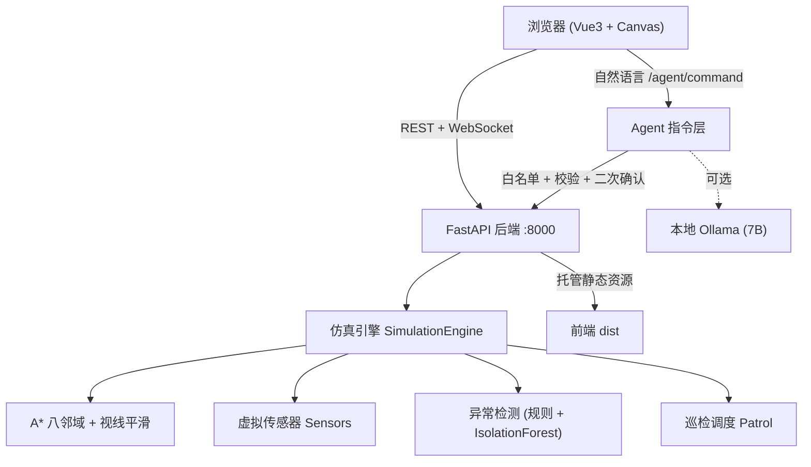

# 智能巡检机器人二维仿真系统 V2.3.2

> 大学生社团培训班结业项目 —— 全栈版（FastAPI 后端 + Vue 前端，单容器部署）。
> V2.3.2 把"只去某一个巡检点"做彻底：规划/预览后点「前往该点（只巡这一个）」就真的只去那一个点，结束后不会继续跑其他巡检点。
> V2.3.1 修了一轮"按钮点了没反应 / 反应不对"的交互问题：按预览路线只去那一个点、不再误报"规划已取消"、不可达时给清障建议、一键排障三种场景都生效、机器人形象多端同步。
> V2.3.0 加了「自然语言 Agent」：说一句话就能让机器人规划、巡检、回充、清障，并支持可选接入本地大模型（Ollama）；同时把 A* 升级为八邻域 + 视线法平滑，异常检测默认改为「有依赖就用机器学习」。
> V2.0 重做了交互（规划=预览 / 遇阻=暂停询问 / 尾迹可隐藏）并修复 22 项一致性缺陷；V2.1 增加地图库、地图设计器与固定屏障，并把"清障"拆成免费的编辑擦除与扣电的机器人清障；V2.1.1 修掉预览缩放过大、关闭预览后视角卡在角落，并把地图库入口补到移动端。

## 项目简介

基于 Web 的二维栅格巡检机器人仿真系统：浏览器中以二维数组渲染栅格地图，一台虚拟巡检机器人在地图上运动。用户可手动遥控，也可用一句话下发指令；机器人用八邻域 A* 自动寻路避障，虚拟传感器（三向超声波、电量、温度）持续采集数据，规则与机器学习（IsolationForest）双策略做异常检测，异常事件经 WebSocket 实时推送到前端。

前端为 Vue 3 + Canvas，后端为 FastAPI（仿真引擎、A*、传感器、异常检测、巡检调度、Agent 指令层），后端同时托管前端静态页，**一个容器即可完整运行**。

## 功能特性

### V2.3.1 修复（交互一致性）

- **「按此路线巡检」只去那一个点**：不再把全图巡检点都排进任务；提示改为"已出发前往巡检点 [x, y]，单点任务"
- **不再误报"路线规划已取消"**：开始巡检会在服务端静默作废预览，不再多推一条取消通知
- **「去 2 号巡检点」能听懂了**：Agent 支持"第 N 号巡检点"，按序号换算坐标，越界会回"当前共 N 个"
- **不可达时给清障选择**：巡检点被围死时暂停弹窗，建议清除某一格后重试，而不是静默跳过；规划失败也会给"拆哪一格能通"的建议
- **一键排障三种场景都生效**：手动撞墙（免费）/ 巡检受阻（扣 5%，继续巡检）/ 有路线预览（按规划批量清障）
- **预览与执行语义一致**：预览卡给出「清除 N 处并前往」和「绕过障碍直接前往」两种明确选择，不再"画着穿墙、实际绕行"
- **机器人形象多端同步**：`GET/PUT/DELETE /api/v1/robot/avatar`，形象版本随状态帧下发，手机和电脑看到同一张图
- **前后端规划口径统一**：前端穿障规划同步为八邻域 + √2 代价，同一路线两端算出的耗电一致

### V2.3.0 新增（自然语言 Agent + 八邻域 A*）

- **自然语言指令层**：右侧面板「智能指令」输入一句话（"去 5,5 巡检"、"回充电点"、"把 3,4 的障碍清掉"），系统解析成白名单工具调用后执行，并回一句人话；解析来源（规则 / 本地大模型）与耗时都显示在面板里
- **工具白名单 + 参数校验**：模型只能从 10 个工具里选，坐标越界、目标不是障碍、电量不足、编辑边界等都在执行前拦下，不会出现"模型说拆哪就拆哪"
- **破坏性操作二次确认**：清障、改格子、复位、新建地图第一次只返回待确认，用户在界面上点「确认执行」才真正生效
- **可选本地大模型**：`AGENT_LLM_ENABLED=true` 后接本地 Ollama（默认 `qwen2.5:7b`），6 秒超时或返回非法 JSON 自动回退规则解析，公网演示不配模型也能用
- **八邻域 A\***：octile 启发、斜向代价 √2、禁止斜穿墙角；200×200 地图平均 6.3ms，路径比四邻域短约 13%
- **视线法路径平滑**：Bresenham 超覆盖检测通视，抽稀冗余拐点后再逐格回填，机器人仍逐格执行、电量与步数不失真
- **BFS 对照实现回归**：`bfs.py` + `tools/benchmark_paths.py`，一条命令复现"A\* 只扩展 BFS 的 15%"的对照实验
- **四邻域口径保留**：`GET /path?diagonal=false` 可切回四邻域，用于课堂对比
- **异常检测默认 `auto`**：装了 numpy/scikit-learn 就启用 IsolationForest，没装静默回退规则；`/health` 的 `anomaly_strategy` 如实报告当前生效的检测器
- **CI 落库**：`.github/workflows/ci.yml`（后端 ruff + pytest、前端 eslint + vitest + build、Docker 构建并探活）

### V2.2.1 修复

- 未带密钥的连接也能收到实时状态（只读浏览），只有下发控制指令时才需要密钥；点控制按钮才弹密钥框，不再一进页面就拦
- 服务端新增 `auth_state` 帧，前端据此显示当前连接是只读还是可操作

### V2.2.0 新增（工程一致性）

- **单一规则源**：电量、传感器、温度、地图尺寸全部来自 `shared/simulation-rules.json`，后端 `config.py` 与前端 `simulatedService` 都读这一份；默认厂房地图来自 `shared/default-map.json`，两端逐格一致
- **操作鉴权**：设置 `OPERATOR_KEY` 后，所有写接口需要 `X-API-Key`，WebSocket 需要 `?api_key=`；前端会弹出密钥输入框，密钥只存 sessionStorage
- **只读模式**：`READONLY_MODE=true` 时写操作统一 403，适合公开展示
- **按 IP 限流**：令牌桶，默认 240 次/分钟、突发 80，超限返回 429 + `Retry-After`；WebSocket 握手同样计数
- **Prometheus 指标**：`GET /metrics` 暴露请求量、限流/鉴权拒绝数、WS 连接数、电量与坐标
- 前端新增共享规则测试，任何一侧改数值另一侧没跟上都会直接失败

### V2.1.1 修复

- 规划预览不再把地图放大到 200%：上限 90%，手机端约 55%；关闭预览会还原原来的视角
- 手机端底部工具条新增「📚 地图库」，并补齐「屏障 / 擦除」工具
- 「更多详情」浮窗改为贴底显示，默认只占下半屏，不再压住地图中央

### V2.1 新增

- **地图库**：保存 / 载入 / 重命名 / 删除 / 导入导出 JSON；本机库（localStorage）与云端库（后端 `data/maps`）双通道
- **地图设计器**：全屏大画布，可放大缩小、自由绘制普通障碍与固定屏障、设置起点/充电点/巡检点；支持改尺寸、导出 JSON、保存后直接载入
- **固定屏障（格子值 2）**：不可穿越、机器人无法清除，只能在地图编辑时人工擦除（带二次确认）
- **清障语义拆分**：编辑期的「擦除」不耗电；只有巡检遇阻时的「清除并继续」才扣 5% 电量
- **规划预览重做**：点预览后地图自动缩放到整条路线，并弹出可拖动的预览浮层（路程/待清障/耗电），可直接「按此路线巡检」，开始后预览自动收起
- **更多详情可拖动**：移动端详情从固定抽屉改为可拖动浮窗

### V2.0 新增

- **巡检遇阻三选一**：停在障碍前一格，弹窗选择「清除并继续（-5%）/ 跳过并记入待清障 / 停止」
- **待清障记录与一键清最近**：跳过的障碍留痕（地图橙色叉号 + 面板计数），按距离由近到远清除
- **新建地图 / 重新开始**：一键新建空白图（可选尺寸）；重新开始保留尾迹，复位则清空
- **尾迹开关**：默认隐藏，可手动显示，线型统一为细虚线
- **随动平移**：取消"平移模式"，任何模式下都能拖拽/滚轮移动地图（障碍模式用右键拖拽）
- **规划 = 预览**：先看闪烁虚线与电力预算，再决定是否开始巡检
- **机器人形象重绘**：机身 + 双轮 + 传感器穹顶 + 朝向箭头 + 状态灯
- **悬停详情**：坐标、是否可通行、到达该格的理论耗电

### 基础能力

- 二维栅格地图编辑（拖动绘制障碍、设置起点与充电点）
- 手动遥控（方向键 / 屏幕摇杆）与自动巡检（最近邻 + A* 贪心路径）
- A* 自动寻路、实时避障、低电量自动返航充电
- 虚拟传感器：三向超声波测距、电量、温度，数据随仿真 tick 联动
- 异常检测：规则阈值 + IsolationForest 在线打分，双策略可切换
- WebSocket 实时状态推送与异常事件通知
- 撞障三连反馈：地图抖动动画 + 卡住弹窗提示 + 一键排障（自动清除前方障碍恢复控制）
- 机器人 2D 平滑移动：位置与朝向指数插值动画，消除格子跳变感
- 内置地图库：默认厂房 / 仓储走廊 / 障碍密集区三张预设一键切换
- 地图导入导出：JSON 格式下载与上传，导入时完整结构校验
- 自定义机器人形象：上传本地图片替换默认绘制，仅存浏览器本地
- 详情表面化：鼠标悬停任意栅格即显示坐标与类型（起点/巡检点/障碍/可通行）
- 真正的地图边界：最外环为固定边界墙——不可绘制、不可擦除、机器人不可穿越，视觉上与普通障碍明确区分（深色斜线纹理），导入地图时自动补齐
- 移动端通知不遮地图：Toast 在手机端改为文档流内布局（仅桌面端悬浮右上角），同屏最多 2 条
- **V1.2 一键路线规划**：一键规划到目标点的理论最短路径（可穿越普通障碍，边界墙不可穿越），地图以**闪烁虚线**展示规划路径，机器人走过的路段自动变为**稳定虚线**
- **V1.2 清障电力预算**：规划路径上的待清障目标以**红色标记**标出（电量不足未纳入的为灰色空心标记）；清障每处消耗 5% 电量，与移动耗电（0.2%/格）合并预算，自动计算电量是否足够到达并决定清障个数
- **V1.2 巡检主动发现障碍**：巡检路径被占用时优先自动绕行，绕不动则把前方障碍标记为待清障目标（地图橙色标记 + 面板一键清除），**不发告警、不中断巡检**
- **V1.2 手动清障**：地图「清障」编辑模式下点击任意障碍即可清除（每处扣 5% 电量），边界墙与非障碍格会被拒绝
- **V1.2 空电搬回**：电量耗尽弹出确认框“机器人已经没有电了，请你将机器人搬回初始点”，选择“是”后才将机器人送回起点并恢复满电
- **V1.2 标号点 / 不标号点地图**：目标点编号可一键开关，设置持久化到本地
- 深色模式、响应式布局，手机浏览器可操作
- 一键部署：Docker Compose 本地单容器（同网段手机可远程控制）/ Render 蓝图公网全栈（手机直接打开链接）

## 系统架构



## 技术栈

- 前端：Vue 3 + Vite + Tailwind CSS + 原生 Canvas
- 后端：Python 3.11 + FastAPI + Uvicorn
- 算法：A\*（八邻域 + octile 启发 + 视线法平滑）、BFS 对照、最近邻调度
- 数据 / AI：numpy + scikit-learn（IsolationForest）；可选本地 Ollama（Agent 解析）
- 实时通信：WebSocket（状态帧 200ms、异常/通知/Agent 事件帧）
- 规则来源：`shared/simulation-rules.json` + `shared/default-map.json`（前后端共用）
- 部署：Docker 多阶段构建（Node 构建前端 → Python 托管）+ docker-compose + Render 蓝图（`render.yaml` 一键公网部署）
- 质量：后端 136 例 pytest + ruff、前端 96 例 vitest + eslint，GitHub Actions 三阶段流水线

## 快速开始

### 方式一：Docker（推荐，一条命令）

```bash
docker compose -f deploy/docker-compose.yml up --build
# 浏览器打开 http://localhost:8000
```

### 方式二：本地运行（两条命令）

```bash
# 1. 后端
cd backend && pip install -r requirements.txt
#    需要机器学习异常检测时再装：pip install -r requirements-ml.txt
uvicorn app.main:app --host 0.0.0.0 --port 8000

# 2. 前端（新终端）
cd frontend && npm install && npm run dev
# 浏览器打开 http://localhost:5173/?backend=http://localhost:8000
```

> 无 Docker 时也可用降级脚本：Linux/macOS 运行 `./run.sh`，Windows 运行 `run.bat`。

### 方式三：Render 一键部署（全栈公网链接，推荐演示用）

仓库根目录的 `render.yaml` 是 Render 蓝图配置，可将「前端 + 后端」作为一个 Web 服务部署到公网：

1. 登录 [render.com](https://render.com)（用 GitHub 账号登录即可，免费套餐无需信用卡）；
2. New → **Blueprint** → 选择本仓库 → Apply（Render 读取 `render.yaml` 自动创建服务）；
3. 等待构建约 3–5 分钟，得到 `https://<服务名>.onrender.com` 链接，手机与电脑均可直接打开。

说明：

- 免费套餐 15 分钟无访问会休眠，再次打开需 30–60 秒冷启动；冷启动期间前端每 5 秒自动重连，连上后恢复，无需刷新；
- 引擎为内存态，休眠重启后地图与机器人回到初始状态；
- 蓝图区域默认 `singapore`（亚洲延迟较低），若 Render 报区域相关错误，删除该行即可；
- 同源部署，无需配置 CORS（前端构建期已开启 `VITE_BACKEND_SAME_ORIGIN=true`，由后端直接托管）。

> 仅需前端公网页时，也可单独使用 GitHub Pages（仓库 `gh-pages` 分支）：Pages 为纯静态托管，跑不了后端，页面会以内置本地仿真器运行；如需接入远程后端，在链接后加 `?backend=https://后端地址` 即可（跨源需在后端环境变量 `CORS_ORIGINS` 中放行 Pages 域名）。

## 用自然语言控制（V2.3.0）

页面右侧面板点「智能指令」，直接输入：

```
现在状态怎么样
去 5,5 巡检
规划到 15,8 的路线
把 12,8 的障碍清掉     ← 会先要求确认
回充电点
停止巡检
```

默认用内置中文规则解析，不需要任何模型。想接本地大模型：

```bash
# 1. 安装并拉取模型（RTX 5060 8GB 可跑 7B 4bit）
ollama pull qwen2.5:7b

# 2. 启动后端时打开开关
AGENT_LLM_ENABLED=true AGENT_OLLAMA_URL=http://127.0.0.1:11434 \
AGENT_OLLAMA_MODEL=qwen2.5:7b uvicorn app.main:app --port 8000
```

模型超时或返回非法 JSON 会自动回退规则解析，不会把界面卡死；`/health` 的
`agent_mode` 会显示当前是 `rule` 还是 `ollama`。工具白名单、校验规则与演示脚本见
[docs/agent.md](docs/agent.md)。

## 访问控制与限流（V2.2.0）

默认是**开放演示模式**：不配置密钥，任何访问者都能操作（启动日志会打一条 WARNING）。要演示"只有持钥者能改"，设置环境变量即可：

| 环境变量 | 默认 | 作用 |
|---|---|---|
| `OPERATOR_KEY` | 空 | 设置后写接口需 `X-API-Key`；WebSocket 可只读接入，下发指令需 `?api_key=`；前端首次操作会弹密钥框 |
| `READONLY_MODE` | `false` | 开启后所有写操作返回 403（只读展示） |
| `RATE_LIMIT_PER_MINUTE` | `240` | 每个客户端每分钟请求数，`0` 关闭 |
| `RATE_LIMIT_BURST` | `80` | 允许的瞬时突发 |
| `TRUST_PROXY_HEADERS` | `true` | 反向代理后从 `X-Forwarded-For` 取真实 IP |

示例：

```bash
OPERATOR_KEY=换成你的随机长串 uvicorn app.main:app --port 8000
curl -X POST localhost:8000/api/v1/robot/move \
  -H 'Content-Type: application/json' -H 'X-API-Key: 换成你的随机长串' \
  -d '{"dx":1,"dy":0}'
```

行为说明：没有密钥的访问者可以正常看到实时地图与机器人状态（只读），点击控制按钮或保存地图时才会弹出密钥框；同一标签页内只输一次，关闭标签页后需重新输入。

边界说明：限流计数与指标都在**进程内存**，单实例有效；多实例部署需要 Redis 等共享存储，本项目刻意没有引入。密钥不要写进 `VITE_*` 变量——那会被打进公开 JS。

## 其他运行配置（V2.3.0）

| 环境变量 | 默认 | 作用 |
|---|---|---|
| `ANOMALY_STRATEGY` | `auto` | `auto` = 有 numpy/scikit-learn 就用 IsolationForest，否则规则基线；`rule` / `ml` 为强制指定 |
| `AGENT_LLM_ENABLED` | `false` | 是否用本地大模型解析自然语言（关闭时用内置规则） |
| `AGENT_OLLAMA_URL` | `http://127.0.0.1:11434` | Ollama 服务地址（不向第三方转发） |
| `AGENT_OLLAMA_MODEL` | `qwen2.5:7b` | 模型名；8GB 显存建议 7B 4bit 量化版 |
| `AGENT_LLM_TIMEOUT_S` | `6` | 大模型超时秒数，超时自动回退规则解析 |
| `AGENT_MAX_GOALS` | `12` | 一句话最多能下发的巡检点个数 |

> Docker 镜像默认不装 ML 依赖（保持轻量）。需要带 ML 的镜像：
> `docker build --build-arg INSTALL_ML=true -f deploy/Dockerfile .`

## API 一览

| 方法 | 路径 | 说明 |
|---|---|---|
| GET | `/api/v1/health` | 健康检查（含 `auth_mode` / `ws_clients` / `anomaly_strategy` / `agent_mode`） |
| GET | `/metrics` | Prometheus 文本指标（V2.2.0） |
| GET | `/api/v1/map` | 获取当前地图 |
| PUT | `/api/v1/map` | 更新地图 |
| GET | `/api/v1/path?start=x,y&goal=x,y` | A* 求路径（八邻域；`&diagonal=false` 切四邻域） |
| POST | `/api/v1/agent/command` | 自然语言指令：解析 → 校验 → 执行（V2.3.0） |
| GET | `/api/v1/agent/tools` | Agent 工具白名单（V2.3.0） |
| POST | `/api/v1/robot/charge` | 主动返回充电点（V2.3.0） |
| GET | `/api/v1/robot/avatar` | 获取自定义形象与版本号（V2.3.1） |
| PUT | `/api/v1/robot/avatar` | 上传自定义形象，多端同步（V2.3.1） |
| DELETE | `/api/v1/robot/avatar` | 恢复默认形象（V2.3.1） |
| GET | `/api/v1/sensors/latest` | 最新传感器读数 |
| GET | `/api/v1/events/anomalies` | 异常事件列表 |
| GET | `/api/v1/patrol/status` | 巡检任务状态 |
| POST | `/api/v1/plan` | 一键规划路线（穿障最短路径 + 电力预算，V1.2） |
| POST | `/api/v1/plan/execute` | 按当前规划批量清障（V1.2） |
| POST | `/api/v1/plan/cancel` | 取消当前路线规划（V1.2） |
| POST | `/api/v1/robot/clear-obstacle` | 手动清除指定障碍格（V1.2） |
| POST | `/api/v1/robot/carry-home` | 空电后将机器人搬回起点（V1.2） |
| POST | `/api/v1/map/new` | 新建空白地图（V2.0） |
| POST | `/api/v1/patrol/decision` | 巡检遇阻决策：clear / skip / stop（V2.0） |
| POST | `/api/v1/robot/clear-nearest-pending` | 清除最近的待清障障碍（V2.0） |
| GET  | `/api/v1/robot/pending` | 待清障记录列表（V2.0） |
| POST | `/api/v1/robot/reset?keep_trail=true` | 重新开始并保留尾迹（V2.0） |
| POST | `/api/v1/map/cell` | 编辑单个格子（0/1/2），不耗电（V2.1） |
| GET  | `/api/v1/maps` | 云端地图库列表（V2.1） |
| POST | `/api/v1/maps` | 保存地图到云端库（V2.1） |
| GET  | `/api/v1/maps/{id}` | 读取云端地图（V2.1） |
| POST | `/api/v1/maps/{id}/load` | 载入云端地图（V2.1） |
| DELETE | `/api/v1/maps/{id}` | 删除云端地图（V2.1） |
| WS  | `/api/v1/ws` | 状态帧（200ms）/ 异常·通知事件帧 / 指令下行 |

WebSocket 指令：`{type:"command", action:"move"|"patrol_start"|"patrol_stop"|"patrol_decision"|"reset"|"restart"|"resolve_fault"|"plan"|"clear_obstacle"|"clear_nearest_pending"|"execute_plan_clear"|"carry_home"|"go_charge"|"cancel_plan"|"new_map", payload:{...}}`。

WebSocket 帧类型：`state`（200ms 状态帧，含 `paused` / `blocked` / `pending`）、`anomaly`、`notice`、`blocked`（巡检遇阻，前端弹窗）、`empty`（电量耗尽）、`auth_state`（连接权限）、`agent`（自然语言指令执行结果）。

## 目录结构

```
project-root/
├── shared/                  # 前后端共用的规则与默认地图（单一事实源）
│   ├── simulation-rules.json
│   └── default-map.json
├── frontend/                # Vue 前端工程
│   ├── src/services/        # 数据服务层（RobotService 接口 + Simulated/Remote 实现 + routePlanner + agent 本地解析）
│   └── src/components/      # 地图、控制、状态、智能指令（AgentPanel）等组件
├── backend/                 # FastAPI 后端
│   ├── app/
│   │   ├── algorithms/      # A*（八邻域 + 四邻域）、BFS 对照、视线法平滑
│   │   ├── services/        # 仿真引擎、传感器、异常检测、巡检调度、路线规划、Agent 指令层
│   │   ├── api/             # REST 与 WebSocket 路由
│   │   └── core/            # 配置、常量、共享规则加载、限流、指标、鉴权
│   ├── tools/               # benchmark_paths.py 路径规划基准
│   ├── static/dist/         # 前端构建产物（由 Docker 多阶段注入）
│   └── tests/               # pytest 单元测试
├── deploy/                  # Dockerfile 与 docker-compose.yml
├── .github/workflows/       # CI：后端 / 前端 / Docker 三阶段
├── render.yaml              # Render 一键部署蓝图（全栈公网）
├── docs/                    # api.md、algorithm.md、agent.md、ai.md、frontend.md、deploy.md
├── CHANGELOG.md             # 版本更新日志
├── run.sh / run.bat         # 非容器降级启动脚本
└── README.md
```

## 测试

```bash
# 后端：ruff 检查 + pytest（136 例）
cd backend
pip install -r requirements-ml.txt pytest httpx ruff
ruff check .
pytest tests/ -v

# 前端：lint + 单元测试（96 例）+ 构建
cd frontend
npm ci
npm run lint && npm test && npm run build
```

路径规划基准（会把统计写入 `docs/benchmark-paths.json`）：

```bash
cd backend
python tools/benchmark_paths.py --size 50 --density 0.2 --samples 100 --perf \
    --json ../docs/benchmark-paths.json
```

CI：`.github/workflows/ci.yml` 在 push / PR 到 `main` 时执行三阶段——
后端 ruff + pytest、前端 eslint + vitest + build、Docker 构建并探活 `/api/v1/health`。
以前这条流水线因为令牌权限（细粒度令牌不含 `workflow` 范围）没能推上去，现在文件已在仓库里，
用带 `workflow` 权限的令牌推送即可自动启用。

## 许可证

本项目为**学习用途**的教学 / 课程作业成果。代码可自由引用与二次学习，引用时请**注明出处与作者**。未经授权不得用于商业闭源产品。
