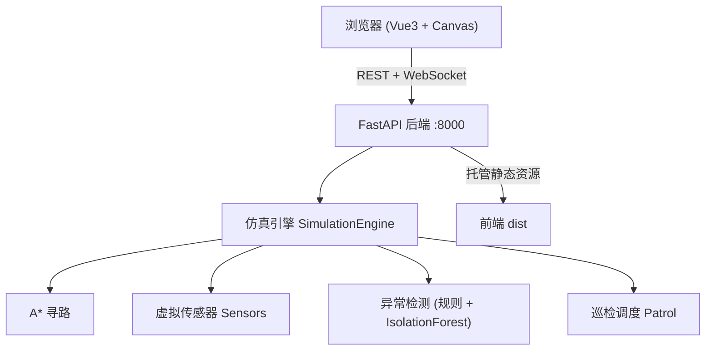

# 智能巡检机器人二维仿真系统 V1.0

> 大学生社团培训班结业项目 —— 全栈版（FastAPI 后端 + Vue 前端，单容器部署）。

## 项目简介

基于 Web 的二维栅格巡检机器人仿真系统：浏览器中以二维数组渲染栅格地图，一台虚拟巡检机器人在地图上运动。用户可手动遥控，也可下发自动巡检任务；机器人用 A* 算法自动寻路避障，虚拟传感器（三向超声波、电量、温度）持续采集数据，规则与机器学习（IsolationForest）双策略做异常检测，异常事件经 WebSocket 实时推送到前端。

前端为 Vue 3 + Canvas，后端为 FastAPI（仿真引擎、A*、传感器、异常检测、巡检调度），后端同时托管前端静态页，**一个容器即可完整运行**。

## 功能特性

- 二维栅格地图编辑（绘制/擦除障碍物、设置起点与充电点）
- 手动遥控（方向键 / 屏幕摇杆）与自动巡检（最近邻 + A* 贪心路径）
- A* 自动寻路、实时避障、低电量自动返航充电
- 虚拟传感器：三向超声波测距、电量、温度，数据随仿真 tick 联动
- 异常检测：规则阈值 + IsolationForest 在线打分，双策略可切换
- WebSocket 实时状态推送与异常事件通知
- 撞障三连反馈：地图抖动动画 + 卡住弹窗提示 + 一键排障（自动清除前方障碍恢复控制）
- 机器人 2D 平滑移动：位置与朝向指数插值动画，消除格子跳变感
- 内置地图库：默认厂房 / 仓储走廊 / 障碍密集区三张预设一键切换
- 地图导入导出：JSON 格式下载与上传，导入时完整结构校验
- 自定义机器人形象：上传本地图片替换默认绘制，仅存浏览器本地
- 详情表面化：鼠标悬停任意栅格即显示坐标与类型（起点/巡检点/障碍/可通行）
- 真正的地图边界：最外环为固定边界墙——不可绘制、不可擦除、机器人不可穿越，视觉上与普通障碍明确区分（深色斜线纹理），导入地图时自动补齐
- 移动端通知不遮地图：Toast 在手机端改为文档流内布局（仅桌面端悬浮右上角），同屏最多 2 条
- 深色模式、响应式布局，手机浏览器可操作
- 一键 Docker 部署，手机与电脑同网段即可远程控制

## 系统架构



## 技术栈

- 前端：Vue 3 + Vite + Tailwind CSS + 原生 Canvas
- 后端：Python 3.11 + FastAPI + Uvicorn
- 算法 / 数据：numpy + scikit-learn（IsolationForest）
- 实时通信：WebSocket（状态帧 200ms、异常/通知事件帧）
- 部署：Docker 多阶段构建（Node 构建前端 → Python 托管）+ docker-compose

## 快速开始

### 方式一：Docker（推荐，一条命令）

```bash
docker compose -f deploy/docker-compose.yml up --build
# 浏览器打开 http://localhost:8000
```

### 方式二：本地运行（两条命令）

```bash
# 1. 后端
cd backend && pip install -r requirements.txt
uvicorn app.main:app --host 0.0.0.0 --port 8000

# 2. 前端（新终端）
cd frontend && npm install && npm run dev
# 浏览器打开 http://localhost:5173/?backend=http://localhost:8000
```

> 无 Docker 时也可用降级脚本：Linux/macOS 运行 `./run.sh`，Windows 运行 `run.bat`。

## API 一览

| 方法 | 路径 | 说明 |
|---|---|---|
| GET | `/api/v1/health` | 健康检查 |
| GET | `/api/v1/map` | 获取当前地图 |
| PUT | `/api/v1/map` | 更新地图 |
| GET | `/api/v1/path?start=x,y&goal=x,y` | A* 求路径 |
| GET | `/api/v1/sensors/latest` | 最新传感器读数 |
| GET | `/api/v1/events/anomalies` | 异常事件列表 |
| GET | `/api/v1/patrol/status` | 巡检任务状态 |
| WS  | `/api/v1/ws` | 状态帧（200ms）/ 异常·通知事件帧 / 指令下行 |

WebSocket 指令：`{type:"command", action:"move"|"patrol_start"|"patrol_stop"|"reset", payload:{...}}`。

## 目录结构

```
project-root/
├── frontend/                # Vue 前端工程
│   ├── src/services/        # 数据服务层（RobotService 接口 + Simulated/Remote 实现）
│   └── src/components/      # 地图、控制、状态等组件
├── backend/                 # FastAPI 后端
│   ├── app/
│   │   ├── algorithms/      # A* 寻路
│   │   ├── services/        # 仿真引擎、传感器、异常检测、巡检调度
│   │   ├── api/             # REST 与 WebSocket 路由
│   │   └── core/            # 配置、常量、异常
│   ├── static/dist/         # 前端构建产物（由 Docker 多阶段注入）
│   └── tests/               # pytest 单元测试
├── deploy/                  # Dockerfile 与 docker-compose.yml
├── docs/                    # 设计文档与部署指南
├── run.sh / run.bat         # 非容器降级启动脚本
└── README.md
```

## 测试

```bash
# 后端：ruff 检查 + pytest
cd backend
pip install ruff pytest pytest-asyncio
ruff check .
pytest tests/ -v

# 前端：lint + 单元测试 + 构建
cd frontend
npm ci
npm run lint && npm test && npm run build
```

CI（`.github/workflows/ci.yml`）在 push / PR 到 main 时自动执行上述后端、前端两步，并验证 Docker 镜像可构建、可启动。

## 许可证

本项目为**学习用途**的教学 / 课程作业成果。代码可自由引用与二次学习，引用时请**注明出处与作者**。未经授权不得用于商业闭源产品。
