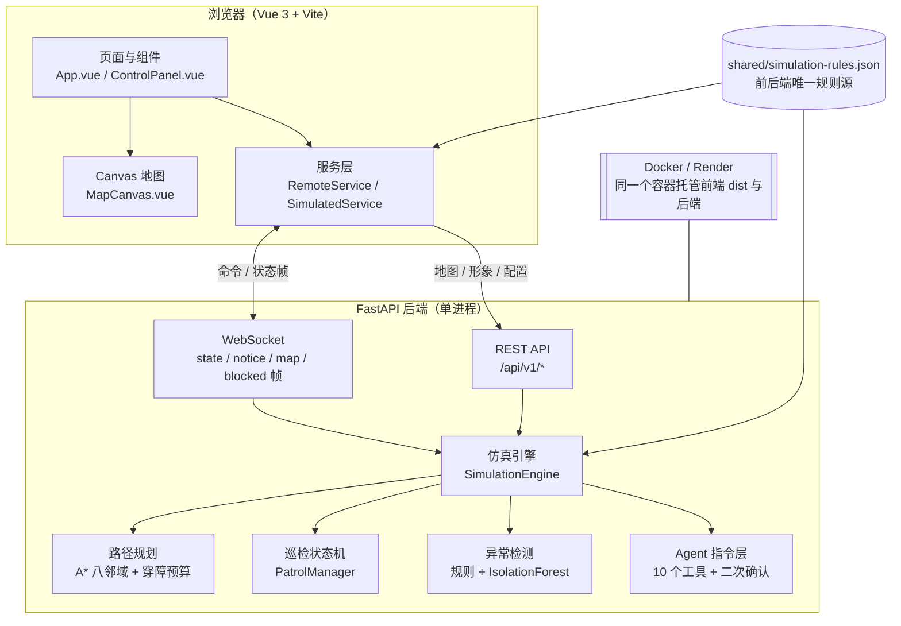

# 系统架构

> 这份文档回答三个问题：**分成哪几块**、**一次操作的数据怎么流**、**为什么这么选**。
> 面向答辩评委、第一次接手代码的人，以及未来的自己。

---

## 1. 总体结构



三个原则：

1. **浏览器只负责画和收指令**，能不能走、耗多少电、算不算异常，全部由后端判断。
2. **两条通道各管一件事**：REST 负责“改状态”（地图、形象、配置），WebSocket 负责“推状态”（机器人在哪、电量多少、发生了什么）。
3. **规则只有一份**：`shared/simulation-rules.json` 同时被后端 `config.py` 和前端 `rules.js` 读取，避免“两套参数对不上”。

---

## 2. 模块职责

| 模块 | 文件 | 职责 | 关键约定 |
|---|---|---|---|
| 页面 | `frontend/src/App.vue` | 组装组件、处理用户操作、维护视图状态 | 所有写操作前先过 `ensureWritable()` |
| 地图画布 | `components/MapCanvas.vue` | 栅格、机器人、路线、尾迹、材质渲染 | 只画，不做业务判断 |
| 服务层（远程） | `services/remoteService.js` | WS 命令、REST 调用、帧分发、鉴权重连 | 优先 WS，失败回退 REST |
| 服务层（离线） | `services/simulatedService.js` | 纯前端仿真，静态站/断网时使用 | 与后端同算法、同规则 |
| REST | `backend/app/api/rest.py` | 地图、状态、异常、Agent、形象 | 写接口要过操作密钥 |
| WebSocket | `backend/app/api/websocket.py` | 命令处理、状态广播、鉴权 | 只读连接也能收帧，不能发命令 |
| 仿真引擎 | `services/simulation_engine.py` | 唯一状态源：位置、电量、模式、地图变更 | 所有状态变化都经过它 |
| 路径规划 | `services/planner.py`、`algorithms/astar.py` | 八邻域 A*、视线平滑、穿障预算 | 直行 1、斜行 √2、不切墙角 |
| 巡检 | `services/patrol.py` | 多点顺序、单点任务、遇阻暂停/恢复 | 状态机，不直接改电量 |
| 异常检测 | `services/anomaly.py` | 规则基线 + IsolationForest | 规则兜底，ML 可选 |
| Agent | `services/agent.py` | 自然语言 → 工具调用，破坏性操作要确认 | 10 个白名单工具，不开放任意代码 |
| 共享规则 | `shared/simulation-rules.json` | 电量、传感器、温度、材质价格 | 改数值只能改这里 |

---

## 3. 一次“开始巡检”的数据流

```text
点击「开始巡检」
  │
  ├─ App.onStartPatrol() → service.startPatrol(goals)
  │     └─ WS: { type: "command", action: "patrol_start", payload: { goals } }
  │
  ├─ 后端 websocket.py 校验权限 → engine.start_patrol(goals)
  │     ├─ planner.astar() 逐点算路 + smoothing 视线平滑
  │     ├─ 每个 tick（200ms）沿路径走一格：扣电、升温、更新传感器
  │     └─ 到达一点后切下一个目标；全部走完 → patrol.finish
  │
  └─ 广播
        ├─ state 帧（5 Hz）：位置、电量、模式、巡检进度
        ├─ notice 帧：规划完成、清障成功、任务结束
        ├─ map 帧：地图被修改（清障/编辑/新建）
        └─ blocked 帧：巡检遇阻（reason = obstacle / barrier / unreachable）
              │
              └─ 前端 RemoteService 分发 → App 更新 → MapCanvas 重绘
```

前端不做“预测性移动”，机器人位置永远以 state 帧为准；这样刷新页面、多端同时打开，看到的都是一致的。

---

## 4. 部署拓扑

```text
                    ┌─────────────────────────────┐
  浏览器 ── HTTPS ──▶ │  Render（单容器）            │
                    │  FastAPI :8000              │
                    │   ├─ /api/v1/*   REST       │
                    │   ├─ /ws         WebSocket  │
                    │   └─ /*          frontend/dist │
                    └─────────────────────────────┘

  备用：GitHub Pages 静态站（无后端）
        浏览器直接跑 SimulatedService，规则与算法同源
```

- 一个容器同时托管前端构建产物和后端，所以部署只要一个镜像。
- 免费实例会休眠，首次访问要等几十秒；演示前先打开一次“唤醒”。
- 静态站是降级方案：断网、评委临时扫码、后端挂掉时都能演示，只是没有真实后端和多端同步。

---

## 5. 关键设计决策

| 决策 | 为什么 | 代价 |
|---|---|---|
| 规则放共享 JSON | 前后端同源，改价格/耗电只改一处 | 构建时要能读到 `shared/` |
| 八邻域 A*（octile、√2、不切角） | 斜走更短、路线自然；不切角避免“贴墙穿缝” | 比四邻域多约 2 倍邻居检查 |
| 视线平滑 | 去掉锯齿，机器人走直线段 | 平滑后要再检查碰撞 |
| 状态帧 5 Hz + 事件帧 | 状态连续、事件不丢；比轮询省流量 | 前端要处理帧乱序/重连 |
| 材质清障预算 | 石头/沙子/金刚石价格不同，规划更有取舍 | 预算要逐格累加 |
| 操作密钥 + 只读模式 | 公开演示时防止别人乱改 | 多一套鉴权流程 |
| 离线仿真回退 | 静态站、断网、后端故障都能演示 | 两套服务层要同步维护 |

---

## 6. 目录与边界

```text
backend/app/
  api/          REST 与 WebSocket 入口
  services/     引擎、规划、巡检、异常、Agent
  algorithms/   A*、BFS、平滑
  core/         配置、常量、规则加载、限流
  models/       地图与机器人数据模型
frontend/src/
  components/   页面组件（只负责展示与交互）
  services/     远程/离线服务层、规则、Agent
  utils/        地图校验、尾迹分段、形象处理
shared/         前后端共享规则与默认地图
docs/           架构、算法、接口、Agent、部署说明
deploy/         Dockerfile、compose
```

边界约定：

- `components/` 不直接调 `fetch`，一律走 `services/`；
- `services/` 不直接改 DOM，只发事件/回调；
- 后端 `api/` 不写业务逻辑，只做参数校验和转发；
- 所有数值常量进 `shared/` 或 `core/config.py`，不在业务代码里散落魔法数字。
