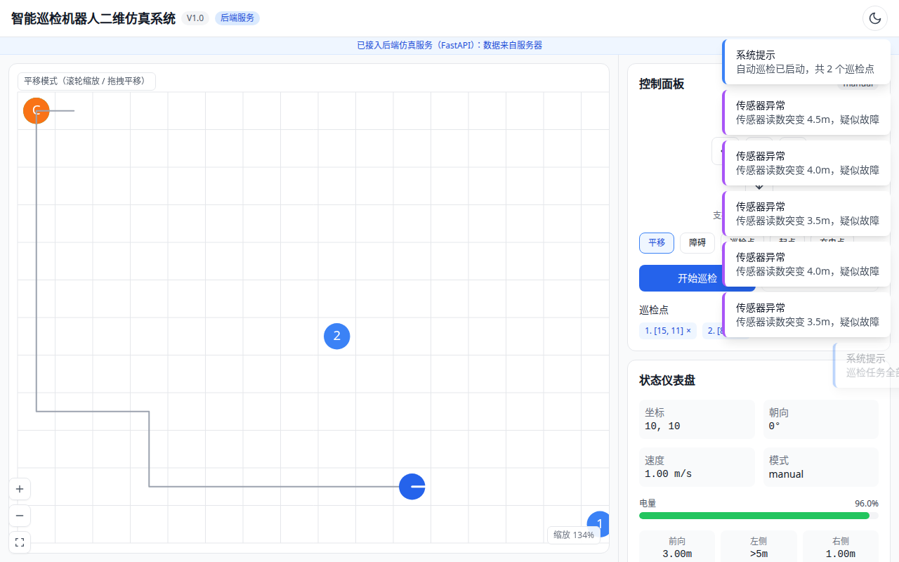
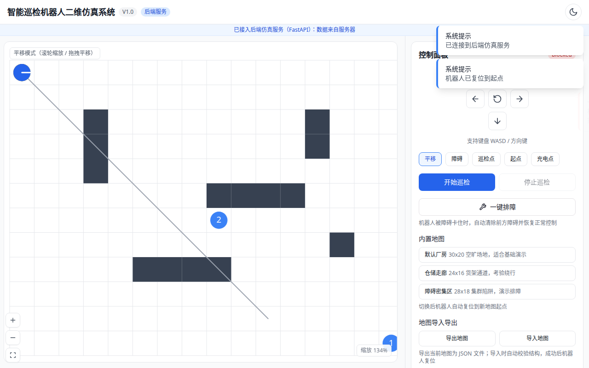
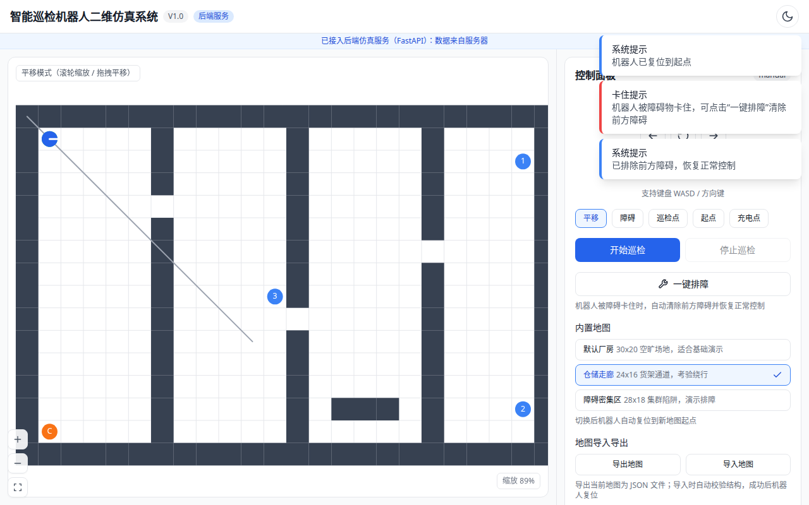
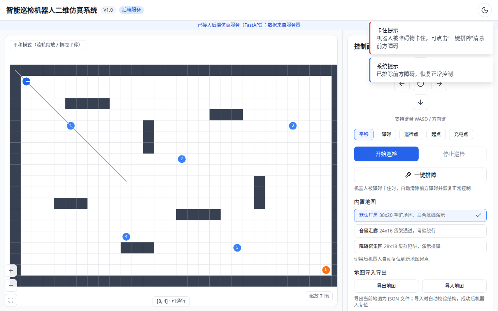
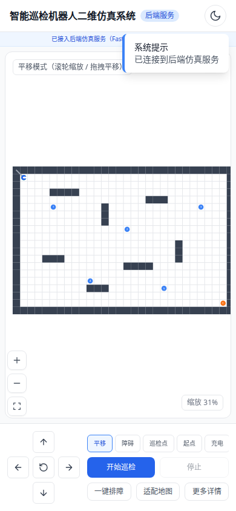

# 智能巡检机器人二维仿真系统 V1.0 软件使用说明书

## 一、软件概述

**软件名称**：智能巡检机器人二维仿真系统
**版本号**：V1.0
**软件用途**：基于 Web 的二维栅格巡检机器人仿真平台。在浏览器中渲染栅格地图，虚拟巡检机器人可手动遥控，也可下发自动巡检任务；机器人使用 A* 算法寻路避障，虚拟传感器（三向超声波、电量、温度）持续采集数据，异常检测引擎实时分析并推送告警。适用于教学演示、算法验证与机器人监控原理展示。

**技术形态**：前后端分离的全栈 Web 应用。后端 Python 3.11 + FastAPI + Uvicorn，前端 Vue 3 + Vite + 原生 Canvas，通信采用 REST + WebSocket，支持 Docker 单容器部署。

## 二、运行环境与部署

### 方式一：Docker 单容器（推荐）

```bash
cd backend
docker build -t irm-v1 .
docker run -p 8000:8000 irm-v1
```

启动后访问 `http://服务器IP:8000`，后端同时托管前端页面，手机与电脑同网段即可访问。

### 方式二：本地开发

```bash
# 后端（端口 3000 或 8000）
cd backend
pip install -r requirements.txt
python -m uvicorn app.main:app --host 0.0.0.0 --port 8000

# 前端（另开终端，开发服务器端口 5173）
cd frontend
pnpm install
pnpm dev
```

前端支持两种数据源，切换对界面完全透明：

- **离线仿真**（默认）：全部逻辑运行在浏览器内，无外部请求，静态托管即可运行；
- **后端服务**：URL 附加 `?backend=http://后端地址` 或由后端同源托管时自动接入，数据来自 FastAPI 仿真引擎。

## 三、功能模块说明

本版本实现任务书全部功能项，逐项说明如下。

### 1. 二维栅格地图与平移交互

- 30×20（可扩展）栅格地图，Canvas 渲染，支持滚轮缩放（0.25~3 倍）、拖拽平移、双指捏合缩放；
- 地图编辑模式：绘制/擦除障碍物、设置起点、设置巡检点、设置充电点，编辑结果自动持久化到浏览器本地存储。

### 2. 手动遥控与自动巡检

- 手动控制：方向键 / WASD / 屏幕方向键 / 摇杆，单步移动，移动消耗电量与温升；
- 自动巡检：设置多个巡检点后一键启动，最近邻贪心排序 + 逐段 A* 寻路，实时显示进度百分比与剩余路径段数；
- 低电量（<20%）自动中断任务并返航充电，充满后恢复。

### 3. A* 自动寻路与避障

- 四邻域 A* 算法，曼哈顿启发函数，返回路径、访问节点数与代价，与后端算法逐行对应；
- 机器人沿路径逐格前进，遇障即停并进入 blocked 状态。

### 4. 虚拟传感器系统

- 三向超声波：以前向、左向、右向射线投射测量最近障碍距离（量程 5 米，超程返回空）；
- 电量：移动 0.2%/格、静止 0.02%/tick、充电 1%/tick；
- 温度：移动升温、静止回落，叠加测量噪声。

### 5. 异常检测（规则 + 机器学习双策略）

- **规则基线**（默认）：单维阈值判定——温度超高、传感器读数跳变、低电量、撞障；
- **IsolationForest**（可选切换）：对电量/温度/三向距离五维特征在线打分。特征经 z-score 标准化消除量纲差异，阈值取正常段分数 2% 分位自动校准，冷启动 500 tick 同步训练，之后每 60 秒后台重训；
- 两类手段互补：规则管"单维超范围"故障，孤立森林管"分布内组合型"异常（如三向探头同时贴低）。

### 6. WebSocket 实时推送

- 后端每 200ms 广播 state 帧（位置、朝向、电量、模式、路径、传感器、巡检状态）；
- 异常与通知事件即时推送，前端以列表 + 弹窗双重呈现，同类告警 5 秒节流防止刷屏。

### 7. 撞障三连反馈（新增）

机器人撞障进入 blocked 状态时：

1. **地图抖动**：整块地图播放 0.36 秒 CSS 位移动画；
2. **卡住提示**：弹出"机器人被障碍物卡住"提示条；
3. **一键排障**：点击后自动清除机器人正前方障碍格并恢复正常控制，正前方为边界墙时直接恢复。

### 8. 机器人 2D 平滑动画（新增）

- 状态帧为 5Hz 格子坐标，直接绘制会产生跳变；
- 渲染层维护动画坐标，以指数平滑（时间常数 60ms）向目标位置插值，朝向按最短路径旋转，收敛后自动停表。

### 9. 内置地图库（新增）

内置三张预设地图，一键切换并自动复位机器人：

| 预设 | 尺寸 | 特点 |
|---|---|---|
| 默认厂房 | 30×20 | 空旷场地 + 固定墙体，基础演示 |
| 仓储走廊 | 24×16 | 三组竖向货架各留缺口，考验绕行 |
| 障碍密集区 | 28×18 | 集群障碍 + 封闭陷阱格，演示排障 |

### 10. 地图导入导出（新增）

- 导出：当前地图保存为 JSON 文件（含宽高、栅格、起点、巡检点、充电点）；
- 导入：选择 JSON 文件，完整结构校验（尺寸范围、栅格完整性、关键点合法性与可通行性），通过后整图替换并复位机器人，失败给出明确原因。

### 11. 自定义机器人形象（新增）

- 上传本地图片（PNG/JPG/SVG，≤2MB）替换默认绘制的蓝色圆形机身；
- 图片以 data URL 形式仅存放于浏览器 localStorage，不经过服务器；可一键恢复默认。

### 12. 详情表面化（新增）

鼠标悬停任意栅格，地图底部即时显示坐标与类型（机器人/起点/充电点/巡检点 N/障碍/可通行），信息直接呈现于界面表面，无需额外点击。

### 13. 路径回放（原有）

巡检结束后可按时间轴回放全过程：机器人位置、轨迹、路径、传感器数据逐帧重现，支持播放/暂停/拖动进度。

## 四、典型操作流程

1. **打开系统**：浏览器访问部署地址，首页显示地图与控制台，右上角徽标显示数据来源（离线仿真/后端服务）。
2. **手动遥控**：点击方向键或按 WASD 移动机器人；撞墙时观察抖动、提示与一键排障。
3. **编辑地图**：切换"障碍"模式拖动绘制墙体，"巡检点"模式点击添加目标，"起点/充电点"模式设置关键位置。
4. **自动巡检**：点击"开始巡检"，观察机器人绕障前进与进度条；任务完成后进入回放。
5. **切换内置地图**：在控制台"内置地图"区选择预设，地图整体替换，机器人复位到新起点。
6. **导入导出地图**："导出地图"下载 JSON；"导入地图"选择文件，校验通过后生效。
7. **更换机器人形象**："上传形象"选择图片，地图上的机器人立即变为自定义形象。
8. **查看告警**：右侧告警列表记录全部异常事件，可导出 JSON。

## 五、界面截图

| 场景 | 截图 |
|---|---|
| 桌面端总览（后端模式） |  |
| 撞障抖动与一键排障 |  |
| 仓储走廊预设地图 |  |
| 悬停详情徽标 |  |
| 移动端界面 |  |

## 六、技术架构与设计原理

```
浏览器（Vue3 + Canvas）
   │  REST（地图/路径/传感器/事件）  +  WebSocket（state 帧 5Hz / 事件帧）
   ▼
FastAPI 后端
   ├── SimulationEngine  仿真引擎（状态机：manual/patrol/charging/blocked）
   │     ├── PatrolManager    巡检调度（最近邻排序 + 逐段 A*）
   │     ├── SensorSimulator  虚拟传感器（三向射线 + 电量 + 温度）
   │     └── AnomalyDetector  异常检测（规则基线 / IsolationForest 可切换）
   └── 静态托管 frontend/dist（单容器部署）
```

**设计要点**：

1. **服务层抽象**：前端定义 RobotService 抽象接口，本地 SimulatedService 与 RemoteService 两种实现互换，界面组件零改动——这是"同一套界面、两种数据源"的关键；
2. **前后端协议一致**：state/anomaly/notice 帧结构与 WebSocket 命令帧在两端逐字段对齐，本地仿真即是后端的镜像；
3. **机器学习落地约束**：仅使用 numpy/scikit-learn 轻量模型，不依赖 GPU 与付费大模型，冷启动同步训练保证首帧即可用，后台线程定时重训适应工况变化；
4. **防御式编程**：地图导入做完整结构校验，WebSocket 断线 5 秒重连，传感器 None 值在 ML 特征中以量程填充。

## 七、版本信息

- 当前版本：V1.0
- 开发方式：单人开发 + AI 辅助
- 源码规模：约 7300 行（后端约 2000 行、前端约 5000 行、测试约 840 行）
- 质量保障：后端 pytest 30 项、前端 vitest 30 项、ESLint 与 Ruff 零告警、Playwright 端到端验证
